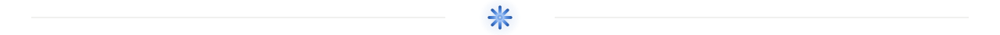

<!-- header banner: auto dark/light -->
<picture>
  <source media="(prefers-color-scheme: dark)"  srcset="assets/eos-banner-aurora-dark.svg">
  <source media="(prefers-color-scheme: light)" srcset="assets/eos-banner-aurora-light.svg">
  
</picture>

<div align="center">


</div>

<div align="center">

### One instruction in. A swarm of Claude Code agents out.

Each in its own git worktree. Working in parallel. Streamed to you live.<br/>
**All on the Max / Pro subscription you already pay for.**

</div>

```bash
curl -fsSL https://raw.githubusercontent.com/ibrahimAlbyrk/eos/main/install.sh | bash
```

<div align="center">

**Real things, built one-shot by a swarm:** &nbsp; [▶ a playable RTS — 39 agents](https://playmore.world/#game/9eb83f07-85d0-46ff-900f-30aaa446a5ae) &nbsp;·&nbsp; [a 64k-word game bible — 12 agents](examples/WITHERREACH-GDD.md) &nbsp;·&nbsp; [browser DOOM w/ multiplayer](https://185.249.197.74.sslip.io/)

</div>

<!-- ╔══ ADD HERO MEDIA HERE ════════════════════════════════════════════════╗
     Record ~10–15s of the live split-screen dashboard with 3–4 workers
     streaming at once. Save it to assets/eos-dashboard.gif and uncomment:
     ╚═══════════════════════════════════════════════════════════════════════╝
<p align="center"></p>
-->

<br/>

<!-- divider -->
<picture><source media="(prefers-color-scheme: dark)" srcset="assets/eos-divider-dark.svg"></picture>

## Quickstart

The one-liner above installs the signed, notarized `Eos.app` from the latest release (Apple Silicon Macs). Sign in to your Claude plan inside the app (Settings › Accounts) and you're set. Eos updates itself from then on (Settings › Updates).

<details>
<summary><b>Build from source · requirements</b></summary>

<br/>

```bash
git clone https://github.com/ibrahimAlbyrk/eos && cd eos
host/scripts/setup.sh          # build tools, esbuild, the dashboard
cargo xtask install            # build, sign (ad hoc without a Developer ID), install /Applications/Eos.app
                               # and put the eos command at ~/.local/bin/eos
eos build                      # the same, from then on, from any folder
eos restore                    # put the previous app back
eos start | stop | restart | status
```

**Needs:** an Apple Silicon Mac · Xcode · rustup · Node 20.19 or 22.12+ with npm (for the dashboard) · a Claude Max / Pro plan. The agent engine ([eos-agent-sdk](https://github.com/ibrahimAlbyrk/eos-agent-sdk)) is fetched by cargo with your git credentials. A build from source does not update itself; run `eos build` again for a newer one. Details: [`DEVELOPMENT.md`](DEVELOPMENT.md).

</details>

<br/>

## How it works

You talk to a persistent **orchestrator**. It breaks your instruction into pieces and spawns **workers** — each in its own git worktree, on its own branch, free to spawn sub-workers or [consult its peers](docs/PROMPTING.md). Or talk to one **focused** agent with Claude Code's full toolset. Eos is one native app: the window, the core that runs every agent, and a **permission gateway** that decides every tool call, all in one process. State and a full event log live in SQLite and stream to the dashboard, your iPhone and your other Macs live.

```
        you ─ "add tests, refactor the session helper, update the changelog"
                                   │
              Eos.app  ·  iPhone (through a relay)  ·  your other Macs
                                   │
                      ╭───────────────────────────╮       ╭──────────────────╮
                      │   Eos core (in the app)    │ ────▶ │   SQLite · WAL   │
                      │  agents · events · policy  │       │  events · state  │
                      ╰─────────────┬──────────────╯       ╰──────────────────╯
                                    │  runs persistent sessions
                      ╭───────────────────────────╮
                      │       orchestrator         │   decomposes one
                      │   persistent · long-lived  │   instruction → many
                      ╰─────────────┬──────────────╯
                                    │  spawn_worker (MCP)
              ╭─────────────────────┼─────────────────────╮
              ▼                     ▼                     ▼
        ┌───────────┐         ┌───────────┐         ┌───────────┐
        │ worker w1 │         │ worker w2 │         │ worker w3 │
        │ worktree  │         │ worktree  │         │ worktree  │
        └─────┬─────┘         └─────┬─────┘         └─────┬─────┘
              │       peers may consult one another       │
              ╰──── every tool call → permission gateway ─╯
                          allow · deny · ask you
```

> **Why subscription, not credits?** Claude's interactive plan (Max / Pro) and the metered API / `claude -p` pool are two different wallets. Eos drives every session against the **subscription** one, through your own sign-in. An API key is used only for a session you explicitly move to it. Point it at a big job, it fans out into a swarm, and the bill stays the flat subscription you're already paying.

<br/>

<!-- divider -->
<picture><source media="(prefers-color-scheme: dark)" srcset="assets/eos-divider-dark.svg"></picture>

## What you get

| | |
| :-- | :-- |
| **Parallel swarms** | One instruction → many workers, each in its own worktree + branch. Pick model and effort per worker. Workers spawn sub-workers. |
| **Dynamic workers** | Not a fixed roster. Beyond the built-ins, the orchestrator **defines new workers at runtime** — `create_worker` sets role, model, tool fences, permission mode, even `extends` inheritance — then runs them with `spawn_worker({from})`. It's how 12 bespoke domain-experts staffed the Witherreach run. |
| **Peer collaboration** | Workers consult one another directly — `ask_peer` / `respond_to_peer` / `list_peers` — instead of routing every question back through the orchestrator. |
| **Live dashboard** | Every session streamed live: tool calls, results, thinking, reports, a task tray, background jobs, Claude Code Workflow runs, a read-only side question (`/btw`). |
| **Split-screen** | Watch up to **4 agents at once** (2-up · 1+2 · 2×2). Click a pane to focus; the header, composer, and side panel follow it — steer one without losing the rest. |
| **In-app Git** | Branches, push / pull without an agent turn, diff + commit viewers, a hunk-level conflict resolver, a **Try** stack, and `integrate_workers` to merge a swarm's branches. |
| **Policy gateway** | YAML decides every tool call: `allow` · `deny` · `ask` (waits for you) · `rewrite`. Per-worker permission modes, inline approval banners, full audit trail. |
| **Assembled prompts** | System prompts composed per spawn from a central library, selected by role and context — never hardcoded. Project memory, your profile and reusable templates are first-class. |
| **Everywhere you are** | Pages, memories, templates and worker definitions sync between your Macs (end-to-end encrypted); control another Mac from this one; drive your agents from the iPhone app. |

<!-- Optional screenshots — drop files in assets/ and uncomment any you like:
<p align="center"></p>
<p align="center"></p>
<p align="center"></p>
-->

<br/>

<!-- divider -->
<picture><source media="(prefers-color-scheme: dark)" srcset="assets/eos-divider-dark.svg"></picture>

## Seen in the wild

The first two came from **a single prompt, no follow-ups.** Eos planned the work, spun up the agents, and delivered.

**🎮 A playable RTS.** &nbsp; One prompt → **39 agents in parallel** → a working Age-of-Empires-style real-time strategy game. &nbsp; **[▶ Play it](https://playmore.world/#game/9eb83f07-85d0-46ff-900f-30aaa446a5ae)**

**📖 Witherreach — a 64,000-word game bible.** &nbsp; One prompt → **12 expert agents** consulting each other (narrative · survival · RPG/combat · tech/co-op · market) → a complete dark-fantasy survival-RPG design doc where the corruption killing the world is your only source of power. 21 chapters. &nbsp; **[Read the GDD](examples/WITHERREACH-GDD.md)**

**👾 DOOM-TS — browser DOOM with multiplayer.** &nbsp; A multi-turn build → a from-scratch raycaster FPS in TypeScript: engine, AI, 9 weapons, 6 original levels — then online co-op + PvP with client-side prediction and lag compensation, a room browser, offline single-player, deployed live. &nbsp; **[▶ Play it](https://185.249.197.74.sslip.io/)** &nbsp;·&nbsp; [source](https://github.com/ibrahimAlbyrk/doom-ts)

<br/>

## How the orchestrator briefs its workers

A sub-agent is only as good as its brief. Eos's orchestrator writes each worker's prompt the way a senior engineer writes a handoff — outcome first, then only the facts the worker can't cheaply discover. *"improve the message queue"* becomes *"add `DELETE /workers/:id/queue` that clears undispatched messages; `npm test` passes; returns `{removed:n}`."* Fan-out is disciplined, not eager: the default is **one** worker, because a wrong split bakes a bad assumption in N times.

→ The full method — disjoint ownership, contract-first swarms, adversarial re-checks, the three-token reporting protocol — lives in **[docs/PROMPTING.md](docs/PROMPTING.md)**.

<br/>

<!-- divider -->
<picture><source media="(prefers-color-scheme: dark)" srcset="assets/eos-divider-dark.svg"></picture>

## Who it's for

| Built for | Not for |
| :-------- | :------ |
| Solo engineers on a Claude Max / Pro plan who want real parallelism. | Teams wanting a hosted, multi-user platform. |
| Operators comfortable with git worktrees and YAML policy. | Anyone trying to escape an interactive billing model. |
| Apple Silicon Macs. | Pipelines that need headless, `-p`-style invocation. |

<details>
<summary><b>Project layout</b></summary>

<br/>

```
crates/ · host/  the app — one Rust program: window shell (Tauri on CEF), core, agent engine
fixtures/        what the 0.1.x app answered, frozen: the reference the app is held to
app/ui/          React 18 + Vite dashboard, bundled into the app
ios/             the iPhone client (SwiftUI)
relay/           the relay for the phone link and the sync vault (deployed separately)
update-server/   the update feed's server
```

Architecture and rules: [`ARCHITECTURE.md`](ARCHITECTURE.md); adding a feature: [`docs/adding-a-feature.md`](docs/adding-a-feature.md).

User data lives in **`~/.eos`** — `state.db`, `policy.yaml`, `config.json`, `templates/`, `workers/`, `pages/`, `profile/`, startup `backups/`. Non-regenerable; never destroyed by tooling.

</details>

<br/>

## Roadmap

**Alpha** — single-author, in daily use, moving fast. Solid today: multi-orchestrator control, worker↔worker swarms, focused chats, the live dashboard, in-app git (push / pull · conflict resolver · Try · integrate), the policy gateway, per-spawn prompt assembly, session resume, sync between Macs, the iPhone app, and in-app updates.

Next: **more backends** (same orchestration layer) · **Windows** on the Rust app.

<br/>

---

<div align="center">
<sub>
<b>Eos</b> &nbsp;·&nbsp; <a href="./LICENSE">MIT</a> &nbsp;·&nbsp; © 2026 İbrahim Albayrak<br/>
<i>An atelier for Claude Code.</i>
</sub>
</div>
